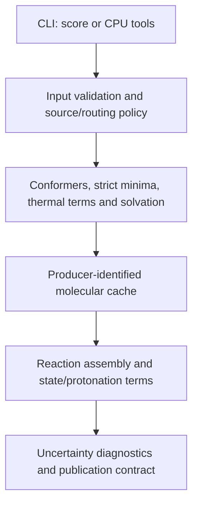

# Architecture

This document describes the evaluated `0.2.0.dev24` package. Dated refactor
results below describe the particular earlier source snapshots on which those
checks ran; they do not replace the [current evidence and status](../analysis/official_default_20261024_01/WORK_STATUS_CURRENT.json).

## Package Map

The maintained import package is `metag` under `MetaG_JCIM`.

| Path | Responsibility |
|---|---|
| `src/metag/chem.py` | Reaction balance and chemical representation helpers |
| `src/metag/reactions.py` | Validated reaction and species input models |
| `src/metag/config.py` | Shared switch defaults and environment compatibility adapter |
| `src/metag/routing/planner.py` | Backend-independent routing stages and balance guards |
| `src/metag/routing/` | Structure-based route selection and transformations |
| `src/metag/assembly.py` | Stoichiometric energy assembly and sampling-error propagation |
| `src/metag/energetics/sampling.py` | Structural sampling budgets with explicit scaling arguments |
| `src/metag/energetics/thermal_ensemble.py` | Thermal bookkeeping with injected correction/combination callbacks |
| `src/metag/energetics/aqueous_states.py` | Hydration and experimental ring-chain mixtures with injected energy callbacks |
| `src/metag/energetics/` | Conformers, UMA, thermal terms, solvation, and species cache |
| `src/metag/protonation_registry.py` | Exact full-reference source models, shared by preflight and scoring |
| `src/metag/state_pools.py` | Experimental fixed-charge ring-state pooling and completeness checks |
| `src/metag/uncertainty.py` | Historical error scales with explicit calibration applicability |
| `src/metag/reporting.py` | CPU uncertainty diagnostics, independent of point-energy assembly |
| `src/metag/validation/` | Reusable parity, provenance, and result audits |
| `src/metag/execution/` | Atomic records and exclusive distributed task claims |
| `src/metag/tools/` | Maintained input, evidence, comparison and calibration commands |
| `src/metag/pipeline.py` | Compatibility API, backend wiring, and remaining QM/scoring orchestration |
| `src/metag/cli.py` | Argument parsing, batch execution, checkpointing and display |
| `tests/unit/` | Fast pure-logic and mocked-backend tests |
| `tests/integration/` | Full-stack tests requiring CUDA, UMA, or xtb |
| `tests/regression/` | Frozen release fixtures and numerical parity tests |
| `tests/performance/` | Reproducible throughput and scaling benchmarks |

Generated caches, sweep outputs, figures, and manuscripts are not package
source. They must be written to caller-selected external directories.

## Dependency Direction

The maintained flow is:



Scientific decisions belong in versioned configuration or narrowly named
policy functions. Execution concerns such as worker count, GPU assignment,
claim directories, and output paths must not alter cache identity or numerical
results.

The routing API can now be imported directly without ASE, Torch, or fairchem:

```python
from metag.routing.planner import route_reaction

routed, diagnostics, truncated = route_reaction(reaction)
```

`metag.pipeline.route_reaction` remains a compatibility facade. The console
entry point and `python -m metag.cli --help` parse arguments before importing
the optional QM runtime. `pipeline.py` binds the callbacks used by the thermal
and aqueous-state modules; those modules do not import the pipeline or read
its globals. Parameter fitting remains under `tools/`, separate from inference.

The ring-chain enumerator is abandoned experimental code retained for later
assessment. `RING_CHAIN` is false by default and is captured by `RoutingPolicy`.
Its structural tests do not validate the associated aqueous free energies.

## Current refactor boundary

The October 6 extraction preserves the behavior present after the pKa
consistency fixes. It does not restore the historical estimator or introduce
new scientific corrections. Verification is recorded in
`../analysis/code_review/refactor_validation.json`: 364 unchanged routes and
364 unchanged paired numerical records, 287 passing tests, one skipped GPU
test, and an isolated wheel import/CLI check with QM imports blocked.

In the dev20 checkpoint, `pipeline.py` retained species calculations, runtime fingerprints and
point assembly. `reporting.py` owns class/feature uncertainty diagnostics, using
the same primitive-extent features as fitting. Production policy rejects legacy
reaction offsets, named-compound pKa lookups, and the solute-only SMD/water
patches before molecular work; their unreachable scoring branches were removed.
Historical numerical reproduction uses each study's frozen source.

`metag tools` lists the maintained commands. Tool dispatch and all command help
remain CPU-only and do not load the bundled scoring panel or QM runtime. Old
module commands and scoring arguments remain available. Fully typed
immutable job settings, a species-energy service, and the remaining result
boundary remain architectural limitations: the numerical worker contract uses
one frozen configuration per process. Concurrent jobs with different settings
in one Python process are not supported. These engineering checks do not
resolve the scientific validation gaps indexed in the current evidence review.

## Refactor Sequence

1. Preserve the frozen implementation and establish release fixtures.
2. Introduce typed configuration while retaining environment compatibility.
3. Extract reaction validation and domain models.
4. Extract routing orchestration, species-energy service, and assembly.
5. Add local and distributed execution around the same content-addressed task.
6. Prove full TECRDB and ModelSEED parity.
7. Move paper-generation tooling and the manuscript only after parity.

Each extraction should be reviewable on its own and should leave the frozen
regression suite green.
