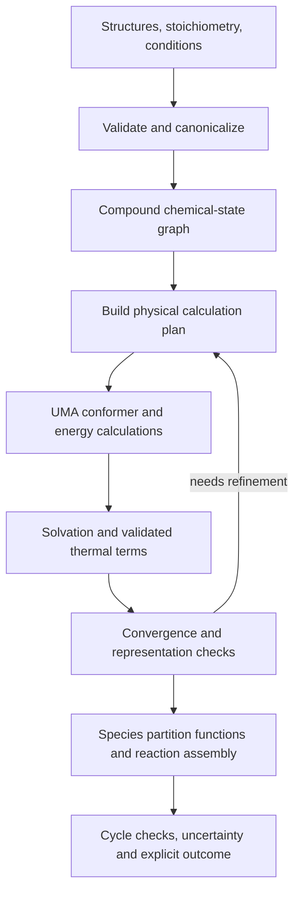

**MetaG comprehensive scientific and code review — 6 October 2026**

The intended contribution is clear: use UMA as the electronic-energy engine of a physically motivated, automatically routed biochemical reaction free-energy calculation. The useful scientific question is whether explicit modeling of the relevant chemistry makes this estimator accurate and transferable without fitting reaction-energy corrections to openTECR. The code substantially implements that idea. Its strongest next improvement is a route-selection system supported by convergence diagnostics and thermodynamic cycles, coupled to a more complete species-state model.

The deployed point estimator reviewed at the start contains no enabled TECRDB-fitted reaction-energy offsets. `ANCHOR_CORRECT` is off. Numerical uncertainty widths are fitted to database residuals, and the hydration model contains a two-parameter fit to independent hydration measurements. Structural routing choices have been evaluated and selected with TECRDB/openTECR in view. These are distinct uses of data. A defensible manuscript description is: “UMA-based physical reaction-energy estimation, with structure-based routing assessed against openTECR and no reaction-energy correction fitted to that database.” Avoid describing every part of the workflow as entirely parameter-free or strictly first-principles.

This review covers the maintained package, routing, energetics, uncertainty/calibration, execution, tests, reference builder, archived predictions, existing diagnostic studies, and manuscript. It combines source inspection, targeted defect reproductions, the existing test suite, recalculation of archived metrics, and a cache-only benchmark replay. It does not replace validation of UMA energies, forces, Hessians, or aqueous chemistry with fresh calculations. No new production QM sweep was launched.

The tree was being edited concurrently. Another agent added `routing/ring_chain.py` during the review. It was briefly enabled, then returned to **default off** before the final checks because its protonation treatment remains unresolved. That work is preserved, belongs to the other agent, and is discussed below. The stored benchmark and cache-replay results here describe the preceding configuration; they must not be attributed to the new ring-chain configuration.

**What is already implemented**

| Component | Implementation and scientific role | Assessment |
|---|---|---|
| Reaction validation | `reactions.py`, `chem.py`: parse structures, check declared charge, reject disconnected species and malformed coefficients; input and rewritten reactions are checked for elemental/proton/charge balance | A strong foundation; balance is necessary but does not prove the accuracy of a representation change |
| Automatic representation selection | `pipeline.route_reaction`, `routing/policy.py`: cofactor cores, NTP cores, full-molecule gate, spectator truncation, neutral-microspecies transform, zwitterion/rearrangement handling | This is a central contribution, not merely orchestration |
| Local reaction models | `truncate.py`, `truncate_global.py`, cofactor/CoA/NTP modules: MCS-based pairing, reaction-center shells, ring preservation, cut restrictions, conserved-fragment checks | Useful physical approximations; some remain reaction-context dependent and need convergence evidence |
| Conformer search | ETKDG/MMFF starting structures, batched UMA ranking and FIRE optimization, symmetry-aware deduplication, adaptive seed batches | Much more substantive than a single minimized-structure calculation |
| Electronic energies | UMA OMol task, explicit charge and spin, float64 downstream arithmetic | Correct attention to charge/spin; downstream conversion cannot restore precision already lost in model outputs |
| Thermal corrections | UMA force finite differences or autograd Hessians, external-mode projection, symmetry/linearity, low-frequency treatment, selected conformer-resolved RRHO | Scientifically substantial; ensemble-wide stationary-point validation remains incomplete |
| Solvation | Default xTB-ALPB at UMA geometries; optional alternate continua, aqueous relaxation, explicit clusters | A sensible baseline, with important limitations for conformational reorganization and coupled charge states |
| Standard states | Solute 1 atm-to-1 M correction, liquid-water reference, proton convention and pH transform | These corrections are essential and should remain independent of benchmark improvement |
| Chemical states | Acid/base rules, hydrated carbonyl microstates, reusable microstate partition code; new ring-chain route | Necessary for biochemical thermodynamics; still lacks a unified coupled state graph |
| Uncertainty | Sampling diagnostic plus internally calibrated class widths; optional feature-based scale | Honest configuration checks exist; chemistry-domain guarantees remain limited |
| Reliability | Species cache, atomic execution primitives, immutable input types, substantial tests and provenance checks | Good starting point; CLI integration and cache validation needed fixes, described below |

For a fixed chemical microstate, the implemented estimator is approximately

\[
G_s^{aq,\circ}=-RT\log\sum_c\exp[-(E_{s,c}^{UMA}+\Delta G_{s,c}^{solv}+G_{s,c}^{thermal})/RT]+\Delta G_{standard\ state}.
\]

Reaction assembly then sums stoichiometric species terms and applies proton/speciation contributions. The physical target is **standard transformed** reaction free energy at the declared conditions, not the intracellular reaction free energy. The latter also requires activities through \(\Delta_rG'=\Delta_rG'^{\circ}+RT\ln Q\).

The existing work also includes investigations of class biases, Mg speciation, phosphagen half-reactions and microsolvation, sugar forms, tautomer enumeration, feature uncertainty, runtime profiling, and ModelSEED applicability. These are valuable evidence about unsuccessful as well as successful hypotheses. They should be preserved as scientific results rather than reduced to a final MAE alone.

**Verified numerical position**

The following values were recomputed from the 364 bundled `metag_opentecr_calibrated` predictions against the bundled openTECR reference. They are properties of that archive, not a new evaluation of the latest defaults.

| Quantity | Value |
|---|---:|
| Number of reaction estimates | 364 |
| MAE | 9.54170 kJ/mol |
| Median absolute error | 7.145 kJ/mol |
| RMSE | 13.31555 kJ/mol |
| Mean signed error | −0.35725 kJ/mol |
| Absolute error greater than 20 / 30 kJ/mol | 35 / 17 reactions |
| Largest absolute error | 60.23 kJ/mol |
| Mean stored 95% interval half-width | 29.47 kJ/mol |
| Stored intervals containing zero | 319/364 |
| Stored intervals covering reference | 353/364; this is **not held-out coverage** |
| Cycle-space dimension | 49 |
| Reactions participating in cycles | 112 |
| Uniformly weighted projection RMS on cycle-supported reactions | 1.52 kJ/mol |
| Largest absolute closure error in the returned integer cycle basis | 16.8 kJ/mol |

The near-zero aggregate bias does not imply that the physical components are unbiased. Class biases can cancel. Phosphagen reactions have approximately +33.69 kJ/mol mean residual across four examples. Reductive-amination dehydrogenases have MAE 14.16 kJ/mol across 11 examples. The largest individual residuals include retinyl-palmitate esterase, ADPglucose phosphodiesterase, thiamin-phosphate pyrophosphorylase, indolelactate dehydrogenase and dihydrofolate reductase; the ranked list is in the review evidence.

The 319-reaction common-set artifact gives MetaG MAE 9.38 and family-grouped held-out dGPredictor MAE 9.91 kJ/mol. The point-estimator development histories differ, so the numerical comparison is descriptive. The 300-reaction ModelSEED archive contains 297 estimates, three failures and 14 flagged estimates. It establishes computational applicability, not accuracy on those unlabeled reactions.

The current cache replay produced all 364 estimates with MAE 9.54363 kJ/mol. Its point estimates exactly match the earlier October 6 cache replay. Twenty-five rounded values differ by 0.1 kJ/mol from the older production archive, a pre-existing cache-provenance difference. The replay used `UMA_HESSIAN=fd` and loaded the source before the concurrent ring-chain addition; its configuration and results are preserved in `analysis/code_review/replay_fd.json`.

**Confirmed defects fixed during this review**

The user authorized immediate critical fixes. The changes below are general implementation corrections; they introduce no reaction identifiers, new pKa values, fitted point offsets, or reaction-specific exclusions.

| Priority | Defect and consequence | Implemented correction |
|---|---|---|
| High | CLI formatted `dG=None` as a float and crashed before publishing results. `None` returns disappeared; a later exception could lose earlier successful work. | Retain every reaction outcome, convert failures to structured no-estimate records, publish atomically after each reaction, and print failed results safely. Interrupts are not swallowed. |
| High | Hydration-state failures could silently leave a carbonyl-only or partial partition while the calculation retained the same calibration identity. | Mark missing requested hydration states explicitly and return no estimate from reaction scoring for an incomplete hydration ensemble. |
| High | Class uncertainty was unchanged when the entire equation was doubled. In the reproduction, 1×, 2× and 10× equations all received a 35.1 kJ/mol half-width. | Normalize the stoichiometric extent for classification and scale class widths, quantile floors and sampling terms consistently. Feature-UQ inputs in the pipeline are normalized and its output widths rescaled. Half-widths are now 35.1, 70.2 and 351.0. |
| High | Core-building eligibility could depend on writing the same equation with unit versus multiplied coefficients, producing a different physical route. | Plan routes at primitive extent, then restore original species/proton/pKa multiplicities for energy assembly. Test point-energy and uncertainty scaling together, including fractional equations and supplied pKa terms. |
| High | Cross-validation grouping treated reverse and multiplied copies of the same reaction as different groups. | Normalize extent and compare both reaction directions. Exact canonical equation matching also handles stereochemical reactions with a zero difference fingerprint. Add a grouping-version field. |
| Medium | Species cache accepted NaN energy, negative uncertainty and records with inconsistent identity metadata. | Validate identity/settings/version and numerical values on read; reject invalid writes and clean temporary files after serialization failure. |
| Medium | `note` was treated as optional in some interfaces but accessed as a required key during scoring. | Supply an empty note at the routing boundary; test a reaction with all incidental note-producing routes disabled. |
| Medium | Feature-UQ fitting described pooled out-of-fold residual calibration as split conformal. | Correct the fitting module's description and newly generated artifact label. Existing numerical artifacts are preserved. |

All 364 benchmark equations have primitive unit extent, so the uncertainty-scaling correction leaves their class widths unchanged. With the corrected grouping and the same archived predictions, grouped calibration uses **238 groups** and reports **0.953** held-out interval coverage; the shipped historical artifact reports **245 groups** and **0.951**. The new diagnostic is stored in `analysis/code_review/evidence.json`. The shipped class/feature calibration artifacts and manuscript numbers have not been overwritten: the latest UMA/ring-chain configuration needs its own complete calibration run, and an archived diagnostic must not be relabeled as validation of that new estimator.

Regression coverage was added in `tests/unit/test_comprehensive_review.py`. The final test/check record is in `analysis/code_review/validation.json`. The early review suite had 231 passing tests and one intentionally skipped GPU integration test; the final run had **254 passing tests and one skipped GPU integration test**, including concurrent ring-chain tests. Twenty-one test cases were added by this review. GPU integration remains unvalidated in this review.

**Remaining scientific and implementation findings, in priority order**

1. **A conserved fragment is not an exact free-energy cancellation guarantee.** `truncate.py`, `truncation_gate.py`, `ntp_core.py` and `cofactor_cores.py` replace entire species with context-dependent cores. Unchanged scaffold connectivity does not ensure unchanged polarization, solvation, intramolecular contacts, conformer populations or electronic coupling to the reacting group. Radius sensitivity is implemented but `TRUNC_VALIDATE` is off by default. The 1.52 kJ/mol projection RMS is encouraging, but the 16.8 kJ/mol explicit cycle sum shows that consequential inconsistencies remain. Inspect the worst cycles individually; report projection residuals and actual cycle sums as different quantities. Treat cycle closure as an internal consistency constraint, not evidence that the energies are accurate.

   A general improvement is an adaptive radius/representation ladder: score R, R+1 and, when feasible, the full structure until the reaction energy and important species terms stabilize. Require chemical-state preservation before accepting convergence. Prefer full structures for unsupported cuts. A physically motivated two-level cycle could combine an accurate core reaction with a cheaper full-minus-core environmental correction, but the lower-level method must independently reproduce that difference. Do not assume an isodesmic label proves cancellation.

2. **Thermal validation is not yet validation of every thermally populated state.** `_ThermalTrack._ensure()` uses `imag_as_soft=True` for tracked conformers. `_thermal_at_minimum()` searches for one accepted reference minimum; `final()` substitutes its validated correction but retains the other tracked states. A significant imaginary mode of another state can therefore contribute through a softened correction without the same validation. The window/cap also ranks by electronic-plus-solvation energy before all thermal corrections are known. An entropy-stabilized state can be missed even if it becomes important in the final free energy.

   Next, retain per-state imaginary-mode diagnostics, validate every state with appreciable final population, and propagate unresolved minima as an incomplete-ensemble status. Iterate thermal screening using free-energy bounds, rather than assuming all states beyond a pre-thermal window are negligible. This needs targeted fresh calculations on rigid controls, sugars, flexible cofactors and known difficult species; it was not silently changed here.

3. **The conformer convergence statistic measures discovery stagnation, not missing-state error.** `implicit_G()` uses the last few cumulative ensemble free energies to compute `sigma`, stopping after sufficiently small increments. Several seeds can miss the same lower basin and produce a near-zero spread. In addition, candidate selection begins with gas-phase UMA energy and gas minima; solution-favored conformers may never reach solvation scoring. `SOLV_RELAX` remains an optional local refinement of gas-derived basins, not a complete solution-phase search.

   Run independently initialized searches, compare increasing pool/keep/budget levels, and measure change in the actual reaction ΔG. Include solution-aware starts or a cheap solution-phase search followed by UMA refinement. Store convergence/capping status, state counts and missing population bounds with each cache record. Do not describe `U_samp` as a rigorous bound on conformer error or use it to dismiss large-molecule applicability concerns.

4. **Speciation is the largest general modeling opportunity.** `pka_transform.py` mixes independent-site approximations, parent-compound constants and macroscopic ladders. The sum of `log(1+10^x)` terms is exact for independent sites, not for an arbitrary set of sequential macroscopic pKas. For a diprotic acid with sequential constants, the fully protonated-reference partition is `1 + 10^(pH−pKa1) + 10^(2pH−pKa1−pKa2)`, whereas the product of independent factors includes an additional state term. At pH 7, well-separated ladders can make that numerical difference small; that does not validate a general titration model. Coupled amino/carboxyl/thiol groups and multiple phosphates need a consistent state graph.

   Generalize the existing `energetics/microstates.py` into a compound-state service. Each state needs structure, charge/spin, proton/water/Mg counts, degeneracy, physical reference convention and data provenance. Combine conformers within a state and chemical states within a metabolite exactly once. Use measured state constants when the transition and conditions match; otherwise use a separately validated prediction method and report the missing/uncertain transitions. Do not tune pKas against reaction residuals. The existing pKa-provenance audit identifies unverified P–N constants and several transferred approximations; those remain unresolved.

5. **The new ring-chain work is relevant and must be integrated as a chemical-state calculation.** The other agent's optional, default-off route enumerates five-/six-membered cyclic hemiaminal/lactam forms and both new-center stereochemical configurations, protects qualifying substrates from truncation, and folds the additional states into the partition. It addresses a real representation problem and fits the intended structure-driven scope. Its source comments report a favorable neutral ring-closure calculation for 2-oxoglutaramate but also document that applying the current acid/base rules cancels much of that stabilization. The ring acid is assigned a generic alpha-hydroxy pKa of 3.8, versus 1.8 for the open alpha-keto acid; the other agent reports approximately 10 kJ/mol sensitivity over a plausible ring-pKa range. This review did not independently repeat those calculations. The module docstring still describes the combined route as validated and needs reconciliation with the explicit default-off policy comment. This is a concrete example of why ring formation and protonation must be validated together, without selecting the missing pKa from reaction residuals.

   Integration checks should cover open-versus-cyclic input equivalence, missing/sanitization-failed states, canonical atom-order invariance, truncated-state caps, both sides of a reaction, protonation changes on cyclization, and combination with hydrated open forms. Ensure the open/hydrated contribution is counted only once when adding ring states. A successful neutral model-compound calculation supports that component; it does not establish transfer across every matching amide/carbonyl environment. Freeze the new route, run all affected reactions and cycles, then the full panel, and recalibrate uncertainty for that configuration. General sugar hemiacetal folding remains separate: the existing sugar study failed its preregistered fructose open-chain criterion (+5.9 kJ/mol versus a 5 kJ/mol limit), and no universal sugar correction should be inferred from the lactam result.

6. **Solvation errors and MLIP errors have not been cleanly separated for all hard classes.** ALPB is a reasonable default, supported by the independent diagnostics already gathered. It is still a semiempirical continuum model at a largely gas-derived geometry. Neutralization reduces some charged-solute problems but moves the dependence to reference-state chemistry and acid/base constants. Agreement of UMA with PBE0 for a small neutral or cationic model does not prove that an aqueous reaction residual is non-electronic: the parent UMA reference level, full molecular context, thermal terms and solvent/state transformations differ.

   Build a component validation panel: UMA versus its parent quantum-chemical reference for matched geometries and spin/charge; parent-reference electronic reaction energies versus higher-level calculations on tractable reactions; thermal sensitivity separately; neutral solvation versus independent transfer data; charged/speciation cycles with consistent conventions. Use higher-level single points or a different continuum only when the relevant component fails that independent test. Do not infer a unique phosphagen mechanism from four signed residuals or unsuccessful small-cluster calculations.

7. **Model configuration and paper configuration have diverged.** `thermal.hessian_method()` now defaults to autograd, but the archived energies and class calibration use finite differences. The initial runtime check correctly reported this mismatch and withheld calibration status. Enabling the new, currently default-off ring-chain route changes the estimator further. Even its added configuration field needs deliberate handling in comparisons to older manifests. The old `PHYSICS_VERSION` string alone cannot describe these configurations. `manuscript/tools/sync_numbers.py` checks the physics version and within-sweep consistency, not equality to the complete currently running estimator; passing that check does not validate the new defaults.

   Preserve the existing autograd development work and validate it; do not rewrite old calibration metadata to make it match. Use a named, immutable release manifest identifying code, full configuration, input/reference snapshots, model checkpoint, environments and exact cache entries. Distinguish the historical figure build from a new release build. Environment switches read at import and switches read during calls currently coexist; changing `UMA_HESSIAN` or `QRRHO` after import can make `_IMPLICIT_SETTINGS` disagree with the actual thermal backend. Resolve a single immutable configuration per scoring job before making this a long-lived service.

8. **Cache integrity is improved, but reproducibility is not complete.** Cache keys contain method settings, canonical SMILES and a manually versioned physics tag. They do not include all dependency/checkpoint/binary identities that enter the calculation; software versions are recorded at the reaction level. A changed backend can reuse an old species value under an otherwise identical key. Canonical cache keys also do not by themselves make a cold calculation invariant to equivalent input atom orders when conformer generation uses the original SMILES ordering.

   Canonicalize the computational input before seed generation, qualify dependency/checkpoint changes with cache boundaries, and archive immutable per-entry checksums. Keep performance-only knobs outside scientific identity only after showing their numerical effect is within an explicit tolerance. Atomic replacement prevents partial files; it does not ensure duplicate workers computed identical results or stop redundant computation. Add per-species claims/leases with owner and crash recovery before large shared-cache runs.

9. **The reference builder is not self-contained.** `artifacts/benchmark/build_opentecr_standard.py --help` fails with `ModuleNotFoundError: build_tecrdb_standard`. The sibling module exists outside `MetaG_new` and refers to original ModelSEED/TECRDB inputs and old output paths. Merely copying that module would not complete reproduction. The pinned reference JSON remains usable, so this is a rebuilding/provenance defect, not evidence that its numerical values are wrong.

   Package the reusable matching/condition-transform code, give every external input and output an explicit argument, pin the original measurement/mapping/speciation snapshots and retain a row-level inclusion ledger. Verify the rebuilt reference against the archive before replacing anything. Measurements were standardized for pH/ionic strength/Mg but remain at measurement temperature; compare a 298 K subset and propagate uncertainty where an enthalpy-based temperature correction is unavailable. Missing pMg is interpreted as no Mg, and missing ionic strength is imputed: quantify those assumptions. eQuilibrator condition differences cancel its fitted standard formation energies, so use of those differences is not itself fitting MetaG point predictions to eQuilibrator; the dissociation/metal/activity model still contributes reference uncertainty.

10. **Uncertainty should support physically meaningful decisions.** The width correction and grouping correction are fixed. Remaining concerns are that class labels partly depend on annotation, database coverage does not establish transfer to novel chemistry, and OOD flags are sparse hand-written warnings. A lack of an OOD flag is not evidence of an in-distribution prediction. The class-scale comparison in `analysis/uq/evaluation.json` also uses a refitted class-scale/conformal protocol, rather than literally reproducing every deployed class-interval rule; label that comparison accordingly.

   Evaluate uncertainty ranking, selective error versus accepted coverage, interval width, class-wise coverage and direction decisions. Treat feature-UQ gains as a candidate improvement, not proof of distribution-free coverage. Pooled out-of-fold quantiles followed by full-data refitting are not ordinary split conformal; genuine split calibration or an appropriate cross-validation construction requires its own statistical assumptions. Near-duplicate groups and shared metabolites also mean an “exact binomial” interval over pooled fold outcomes is not an exact uncertainty statement for the whole learning procedure. Use group-aware resampling and retain fold assignments and actual success counts.

   Shared species errors induce correlated reaction errors. For network use, propagate a species/state covariance through stoichiometry, `Σ_reaction = Sᵀ Σ_species S`, augmented by explicit representation errors. Independent reaction intervals can create thermodynamically inconsistent perturbations. The 319/364 zero-containing standard-state intervals motivate an application using concentrations and pathway constraints rather than advertising confident reaction signs from ΔG° alone.

11. **Several claims in comments/manuscript exceed the evidence.** Examples include generic assertions that spectator cores cancel “exactly,” that universal-model training establishes applicability of aqueous metal chemistry, and the manuscript's categorical elimination of electronic/pKa contributions to phosphagen errors. Existing diagnostic audits are more careful than some of these comments. Update narrative claims to the precise tested species, method, conditions and observable. The “no fitted database reaction-energy corrections” claim is supported; a claim of proven arbitrary-chemistry generalization is not yet supported.

12. **Release engineering should make the physics reproducible.** `pyproject.toml` does not pin a tested environment; `test` dependencies alone do not supply the eagerly imported torch/fairchem stack used by pipeline tests; default xTB paths are tied to a home-directory conda layout. Autograd accesses internal fairchem interfaces, so compatibility needs an explicit version range and a small backend contract test. The CLI now safely publishes outcomes, but is not yet a full resumable species-task scheduler. The main pipeline still combines routing, chemistry, backends, uncertainty and execution in one large module.

   Extract configuration, route planning, species computation and assembly behind narrow interfaces. Make pure routing importable without loading the QM backend. Add a documented minimal CPU test environment, a pinned QM environment, startup backend checks, a tiny opt-in real-backend contract test, and cold/warm-cache runtime benchmarks. Full restart support should reuse records only when input and configuration hashes match. Do not replace this work with a large generic refactor before the scientific invariants are pinned.

**How to make routing generalizable without database-specific exceptions**

The correct boundary is between chemical/numerical knowledge and reaction-specific outcome knowledge. Structure-based rules are appropriate when they encode chemistry and expose their applicability. They are not automatically validated merely because they avoid reaction identifiers.

| Rule type | Appropriate treatment |
|---|---|
| Physical constants and unit conversions | Fixed, sourced and tested |
| Measured pKa, hydration or binding constants | Key to the actual state transition and conditions, with source and uncertainty |
| Chemical transformations | Detect from molecular graph, stoichiometry and electronic state; validate independently of reaction residuals |
| Numerical cutoffs and sample budgets | Justify with convergence/sensitivity data; adapt when possible |
| Parent functional-group approximations | Explicit approximate fallback with applicability/uncertainty, not “experimental pKa for this molecule” |
| Reaction-ID exceptions or fitted class energy offsets | Keep out of the general deployed point estimator |
| Empirical uncertainty calibration | Keep separate from point estimation and label the dataset/domain |

The strongest future route output is a reviewable thermodynamic calculation plan: the original species states, any replacement/capping cycle, every reservoir exchange, chosen backend/settings, convergence evidence and residual approximation. The router should escalate because a physically relevant diagnostic failed, rather than because a particular benchmark reaction had a large residual.

A suggested architecture is:



For the state graph, a common reservoir convention is essential: transform each state's free energy by the chemical potentials of the protons, water and bound metals that differ relative to a declared reference, then perform a stable log-sum-exp. Hydration, protonation, tautomerism and cyclization can be coupled; applying independent corrections in sequence is justified only when it reproduces the joint partition and avoids duplicate states. Maintain explicit stereoisomer identities: unspecified input stereochemistry is not automatically permission to equilibrate all stereoisomers.

**A prioritized improvement program**

| Order | Work package | Acceptance evidence |
|---|---|---|
| 1 | Finish ring-chain integration and freeze one release configuration | Full source/config/cache/input manifest; replay and fresh-backend checks agree within stated tolerances; figures/calibration identify that exact release |
| 2 | Route and representation invariants | Forward/reverse, positive and fractional scaling, species ordering, equivalent SMILES/protonation drawings, duplicate species, annotation and ID changes tested across broad chemistry; investigate genuine convention differences rather than forcing equality |
| 3 | Conformer/thermal convergence panel | Independent searches and budget increases on representative chemistry; all populated states validated; observed ΔG changes below predeclared application tolerances |
| 4 | Thermodynamic-cycle routing | Radius/full-core comparisons, cap sensitivity, cofactor cycles and worst network cycles; reported representation-error estimate per reaction |
| 5 | Coupled speciation and independent component tests | pKa transitions, ring/open/hydrate populations, neutral solvation and metal-binding data at matched conditions; no parameters selected from reaction residuals |
| 6 | Freeze and test generalization | External reaction measurements or a clearly separated untouched chemical/source/temporal set, with duplicate and overlap checks; common baselines evaluated at the same conditions |
| 7 | Demonstrate biological value | A pathway or design decision inaccessible/ambiguous with existing estimates, with concentration ranges and correlated uncertainty propagated; ideally a prospective equilibrium measurement |
| 8 | Publish reproducible performance | Species reuse, cold/warm cost, p50/p95 reaction cost, GPU memory and failure accounting; scale from actual unique species rather than a few examples |

The profiling archive suggests that optimization and Hessians dominate several representative jobs; Python graph/transfer overhead was only around 2–3% in those examples. The new autograd work is therefore well motivated. Prioritize validated Hessian reuse, avoiding repeated solvation of identical geometries, species-level scheduling and adaptive budgets before optimizing low-cost bookkeeping. The five archived profiles are not a genome-scale speed benchmark.

For scientific ablations, preserve physical conventions. A deliberately inconsistent standard state can be a diagnostic but should not become a candidate production method because its aggregate MAE improves. Prefer component/route ablations with the same reference and report paired reaction-level changes, failure counts, cost and class-specific effects. Freeze the choices before assessing the final external set. A preselected diverse panel of tens of component cases and approximately 100 or more independent reaction tests would be a useful planning scale, not a universal sample-size requirement; determine statistical power from the desired precision and available independent groups.

**Publication positioning**

My assessment is that this is a credible methods project with a substantive physical workflow. A broad, high-impact claim needs the extra evidence that automatic representation selection transfers and that the resulting energies enable a useful scientific conclusion. Improving one overall MAE by adding more special cases would weaken the central story. A validated physical router, transparent component error diagnosis, a released thermodynamic dataset and an experimentally supported metabolic application would strengthen it.

The novelty should be the combination of scalable MLIP energetics, physically justified automatic representation/state selection, explicit reliability checks and biochemical utility. Quantum-chemical estimation of metabolic energies already predates this project: [Jinich et al. 2014](https://www.nature.com/articles/srep07022) established the approach and its charged-species challenges. [Jinich et al. 2018](https://pmc.ncbi.nlm.nih.gov/articles/PMC6218094/) connected computed redox thermodynamics to biological principles, including the role of NAD(P). Those papers make an application-level scientific conclusion particularly valuable here.

The comparison should also explain what this approach adds to [eQuilibrator 3.0](https://pmc.ncbi.nlm.nih.gov/articles/PMC8728285/) and [dGPredictor](https://pmc.ncbi.nlm.nih.gov/articles/PMC8496854/): direct use of molecular energetics and independently justified chemical-state modeling for chemistry poorly constrained by reaction training data. It should not imply that eQuilibrator lacks speciation or uncertainty machinery. [The UMA model documentation](https://github.com/facebookresearch/fairchem/blob/main/docs/core/uma.md) specifies task-dependent behavior and molecular charge/spin inputs; “universal” does not itself establish accuracy of this aqueous free-energy workflow. Recent [foundation-potential redox benchmarking](https://doi.org/10.1021/prechem.5c00258) is also relevant prior work for the distinction between MLIP geometry/thermal utility and electronic/solvation accuracy; inspect its full paper before making quantitative comparisons.

Useful paper figures would be: the physical calculation/routing scheme; independent component validation with uncertainty; paired route/convergence ablations and worst-cycle diagnostics; an honestly labeled benchmark plus external test; and a metabolic application with computation cost and selective reliability. The current manuscript already makes several careful distinctions about calibration and development performance. Retain those distinctions while making the general physical modeling contribution more prominent.

The statistical terminology correction follows the distinction between split and cross-conformal methods discussed by [Vovk et al.](https://arxiv.org/abs/1911.00941). It is a labeling/validation issue, not a reason to discard useful empirically calibrated intervals.

**Review artifacts and reproduction**

- [CPU review checks](../analysis/code_review/review_checks.py), [initial evidence](../analysis/code_review/evidence_before_fixes.json), and [post-fix evidence](../analysis/code_review/evidence.json). The initial missing-note probe accidentally reached a mocked-less backend and is not used as proof; the controlled regression test establishes that interface defect.
- [Cache-only replay](../analysis/code_review/replay_fd.json), with individual records under `analysis/code_review/replayed/`. Backend calls and cache writes are forbidden by the replay script.
- [Regression tests](../tests/unit/test_comprehensive_review.py) and [validation record](../analysis/code_review/validation.json).

From `MetaG_new`, use the project's UMA environment:

```bash
PYTHONPATH=src /homes/rzhu/miniforge3/envs/uma/bin/python analysis/code_review/review_checks.py
/homes/rzhu/miniforge3/envs/uma/bin/python -m pytest -q tests/unit tests/regression tests/integration --disable-warnings
```

The old-configuration replay was launched before the ring-chain addition, with `UMA_HESSIAN=fd`. Repeating it on the latest source requires an explicitly chosen historical configuration and compatible calibration metadata; disabling a new route is not equivalent to validating the new route. For the current default configuration, fresh results and a configuration-matched uncertainty calibration are still required.

## Follow-up: generalization safeguards and large-error experiments

This follow-up goes beyond the numerical-parity refactor. It does not establish
an accuracy improvement. The 17 baseline errors above 30 kJ/mol were examined
with six structural/reference/provider ablations each: **102 attempts**, of
which **74 reused existing QM**, **24 lacked the required cache entries**, and
**4 were outside the optional site-pKa provider's domain**. Missing computations
were recorded rather than silently replaced by another method. These diagnostic
results precede the P-N quarantine described below.

| Investigation | Discriminating evidence | Decision |
| --- | --- | --- |
| Arginine, taurocyamine, lombricine kinase | The routes collapse to one shared core. Fresh GPU calculations of two neutral guanidine cores shifted its prediction by −87.15 kJ/mol, from approximately +34.49 to −52.66. Keeping the same pKa terms across these different microstates does not close the thermodynamic cycle. | Do not enable global neutralization as a residual fix. Develop a coupled protonation/tautomer/solvation cycle using independently supported transitions. |
| P-N pKa provenance | The historical first value 2.70 is attributed to phosphocreatine, but an independent measurement assigns the near-2.7 value to its carboxyl group. Transferring the measured macroscopic ladder to fully acidified reference states is also unsupported. | Quarantine automatic P-N assignment; keep historical constants for inspection. Do not substitute an upper bound or fit a new constant to reaction errors. See `pka-provenance.md`. |
| FBP aldolase | Hydration already lowers the result by about 8.56 kJ/mol. Predicted DHAP carbonyl fraction is 55.7%, near the independent 55% observation at 20 °C. Raw uncalibrated hydration improves this outlier but worsens matched aldolase/TIM controls. | Reject the uncalibrated-hydration switch. Additional reactant ring stabilization has the wrong sign. Investigate phosphate reference/solvation nonadditivity with balanced matched cycles. |
| Indolelactate dehydrogenase | A lactate matched cycle cancels the current NAD, proton and pKa terms, leaving about 45.17 kJ/mol disagreement. The source row itself has an unresolved primary-literature flag concerning a factor-of-ten K′ discrepancy. | Verify the experimental direction, proton convention and K′ before using this case to change the estimator. The factor-of-ten issue alone is about 5.94 kJ/mol at 310.15 K, not an explanation of the entire residual. |
| Retinyl-palmitate esterase | The source labels its K as approximate and kinetic-derived, at 310.15 K. The primary abstract describes bile-salt-stimulated lipase and a ratio of rate constants. The current gas-minimum ensemble is large but does not prove aqueous sampling convergence. | Verify phase/activity conventions and temperature before expensive resampling. The primary abstract alone does not establish that the benchmark value is invalid. |
| Thermal/sampling approximations | Cached per-conformer versus shared thermal corrections change retinyl, ADPglucose and thiamin reaction energies by only −1.29, −0.67 and −1.87 kJ/mol. Controlled synthetic tests show cap/window truncation can nevertheless omit important thermally reordered minima. | Record sampling trajectories and thermal coverage; do not call a small last-batch spread a bound on missing basins. These synthetic errors are not measured corrections for the real reactions. |

The independent hydration observations, their temperatures, and the matched
control results are recorded in
[`aqueous_diagnostics.json`](../analysis/code_review/aqueous_diagnostics.json).
The retinyl primary source is
[O'Connor, Butler and Yaghi (1990)](https://www.sciencedirect.com/science/article/abs/pii/030451029085274L).
The indolelactate source is [Jean and DeMoss (1968)](https://doi.org/10.1139/m68-068);
its full text was not available in this investigation, so the source disagreement
remains unresolved rather than being corrected by choosing the better residual.

Implemented correctness changes:

- Production routing rejects legacy benchmark anchors, named-polyacid lookups,
  and the hydro-lyase water offset. Phosphonate/phosphite environments cannot
  borrow phosphate constants; missing ladder entries cannot be fabricated.
- Automatic phosphoramidate pKas are quarantined. Missing neutral
  guanidine/amidine base terms were fixed using the existing supported class
  rules, with no new numerical pKas. This repairs representation consistency;
  it does not validate the class constant or coupled microstates.
- Hydration and experimental ring-chain enumeration fail closed when their
  state caps omit required states. Ring-chain remains off by default.
- Fresh implicit species caches record actual sampling trajectories and stopping
  criteria; reaction diagnostics expose those and thermal approximation coverage.
  Historical caches explicitly lack those diagnostics. Numerical energies,
  sampling sigma and cache identities were not changed by this metadata work.
- Benchmark rebuilding now refuses measurements whose recipes explicitly contain
  Mg but lack free Mg activity/pMg, and flagged misannotated equilibrium values.
  Total magnesium is not substituted for free activity. Other unknown conditions
  remain explicit assumptions, not resolved data. Archived labels were not rewritten.
- The full-source condition audit covers **5,816 measurements**, including
  **1,205 explicit-Mg/unknown-free-pMg records**. This is not a count of errors
  among the 364 selected reactions. In particular, the `89ELL` phosphagen recipes
  contain magnesium acetate while their pMg cells are blank.

Final cache replay retains **358/364 point predictions**, with no rounded ΔG
changes among these 358 versus the prior refactor replay. Six reactions now
receive no estimate: four requiring quarantined P-N parameters and two requiring
unsupported phosphonate parameters. Their exclusion must not be advertised as
improved MAE. The ModelSEED preflight remains a 300-reaction panel, not proof of
full-database accuracy or complete speciation coverage.

Evidence: [`generalization_final_replay.json`](../analysis/code_review/generalization_final_replay.json),
[`large_error_ablation.json`](../analysis/code_review/large_error_ablation.json),
[`phosphagen_neutral_qm.json`](../analysis/code_review/phosphagen_neutral_qm.json),
[`sampling_mechanism_probes.json`](../analysis/code_review/sampling_mechanism_probes.json),
[`reference_conditions.json`](../analysis/code_review/reference_conditions.json).

Validation after integration: **344 tests passed** (54 warnings). The source and
evidence manifest is [`generalization_validation.json`](../analysis/code_review/generalization_validation.json).

## Planning refresh: next scientific development stage

This section supersedes the older sequencing above. It is a plan, not a report
of newly validated accuracy. The reference rebuild now **is installed**; the
previous labels are archived. The subsequent integration passed 351 tests.
The collaborator deck in `../slides/MetaG.tex` summarizes the current workflow
and this plan. No new QM sweep was launched for this planning review.

### What the current evidence supports

- The 364-reaction structural panel remains intact. The audited cache replay
  retains 358 predictions and withholds six unsupported phosphorus cases;
  retained rounded predictions did not change in that comparison.
- There are 54 retained reference labels from 1,256 measurements. Only 18
  reactions have at least one eligible row at exactly 298.15 K (363 rows).
  Requiring reported ionic strength as well leaves eight reactions (168 rows).
  These are measurement-subset counts, not ready-made reaction labels. Existing
  medians may mix temperatures and must be rebuilt for each evaluation subset.
  Exact temperature matching is an audit criterion; a scientifically justified
  tolerance or temperature transformation should be specified before evaluation.
- Of the used measurement rows, 268 have multiple ModelSEED matching candidates.
  This is not proof of an incorrect assignment, but selecting the first sorted
  match is not a sufficiently justified identity-resolution policy for a final
  benchmark. Inspect proton/water conventions, compounds, stereochemistry,
  reaction direction, and compartments before consolidating matches.
- The 300-reaction ModelSEED preflight has 265 review cases, 34 with no known gap
  detected, and one blocked case. It does not establish full-database coverage.
- Diagnostics and exclusions are stronger; a reduction of physical prediction
  error has not yet been demonstrated. Historical MAE and interval coverage must
  remain attached to their original estimator and reference selection.

### 1. Establish a usable evaluation set before interpreting residuals

Re-score compatible cached predictions against measurement-level references.
Separate resolved measurements from uncertain-condition measurements and
unresolved constants; retain provenance and uncertainty rather than averaging
incompatible temperatures into one apparent target. Repeated measurements from
one study are not independent validation reactions. Audit phase/activity
conventions, equilibrium definitions, orientation, mapping ambiguities, and
experimental uncertainties. Report coverage and the chemistry composition of
all evaluation subsets so strict selection does not masquerade as accuracy.

Prioritize primary-source recovery by information value and number of reactions
restored. Free Mg can only be recovered from sufficient composition, activity
and binding information. For unknown Mg conditions, also investigate whether a
conservative sensitivity bound is possible: a demonstrated negligible effect
could justify using an otherwise sound measurement without assuming a free Mg
activity. Do not treat absence of binding constants as evidence of no binding.
Missing ionic strength should remain flagged; test sensitivity using justified
bounds. Preserve unresolved rows rather than guessing constants to improve fits.

**Deliverable:** a ranked residual list with comparable conditions, an explicit
reference-recovery queue, and frozen evaluation subsets. No fresh UMA is needed
for reference changes alone. Historical finite-difference cache replay must not
be presented as validation of the current autograd default.

### 2. Close numerical-validation gaps on a small fresh panel

The thermal tracker calls corrections with `imag_as_soft=True`; only the
selected reference receives the full minimum-resolution treatment. Other
populated ensemble members therefore need their own stationary-point validation.
Resolve substantial imaginary modes, recompute energies after geometry changes,
and exclude or explicitly fail unresolved states. Expand thermal caps and
windows and compare reaction free energies; current outside-window reference
corrections do not provide an error bound.

On fixed geometries, compare autograd and finite-difference Hessians, projected
modes, and thermal corrections. Then test independent seed ensembles, increased
candidate/retention budgets, solvent-aware ranking, and deduplication sensitivity
on rigid controls and flexible/charged species. Current convergence checks use
cumulative ensembles and a gas-energy minimum; a plateau is not evidence that
low-free-energy aqueous basins were found. Define a numerical error budget before
choosing convergence tolerances and record computation cost.

**Gate:** materially populated states satisfy the minimum policy; numerical
sensitivity is acceptable relative to the declared reaction-energy error budget,
or the result is flagged/withheld. This is a correctness gate independent of MAE.

### 3. Replace ambiguous protonation bookkeeping with explicit states

Keep the independent-site evaluator only where its assumptions are justified.
Represent sequential macroscopic ladders with the correct population polynomial;
for coupled microscopic states, preserve graph, charge, proton count, degeneracy,
reference microstate and transition provenance. A macroscopic ladder alone cannot
identify a QM tautomer. Reuse the stable partition machinery in `microstates.py`,
but do not add population-derived full state gaps to independently computed gaps
and thereby count the same free-energy difference twice.

Start with supported simple acids/bases as controls, then interacting acid sites,
aromatic nitrogen and guanidine/amidine systems. Keep P-N and unsupported
phosphorus environments quarantined until suitable state-specific evidence is
available. Parameter provenance should include solvent, temperature, ionic
strength, micro/macroscopic meaning, uncertainty and applicability. External
property models may supply parameters, but must be validated independently of
reaction residuals. A data file replacing a compound lookup does not itself make
the model generalizable.

**Gate:** alternative input drawings, reaction reversal, stoichiometric scaling,
spectator cancellation and reference-state cycles agree; independent pKa and
population data support the proposed domain. Do not promise that correcting this
bookkeeping alone will remove the large-error tail.

### 4. Distinguish solvation, state enumeration and core errors

Use paired calculations on the same species, charge/spin and reference state.
Compare vertical ALPB with solvent-aware exploration on a small panel. The
optional solvent-relaxation path carries gas-basin thermal information and does
not prove a complete aqueous ensemble. Explicit-water experiments require a
balanced cluster/continuum cycle, standard-state terms, and water chemical
potential; increasing cluster size alone is not a defensible correction.

Revalidate the hydration model on independent populations and matched reaction
controls. Ring-chain and tautomer work should begin with enumeration completeness,
stereochemistry and independent aqueous population checks, then test both sides
of reactions. Retain the abandoned ring-chain implementation as experimental.

For cores, compare R, R+1 and feasible full-molecule results across charged and
neutral spectators, flexible scaffolds and multiple reaction contexts. Structural
balance cannot prove cancellation of electrostatics or conformational entropy.
Use cycle residuals to diagnose representation inconsistency, not as an accuracy
metric or a post-hoc offset-fitting mechanism. Check UMA electronic energy gaps
against matched-level DFT on small representative cores before attributing every
residual to solvation. No checkpoint upgrade should enter silently.

**Gate:** a proposed physical change has independent support, behaves consistently
on a predefined affected panel, and has no unexplained regressions on controls.
The earlier neutral-phosphagen and raw-hydration alternatives remain rejected.

### 5. Finish the engineering needed for controlled experiments

Freeze one immutable configuration per job. Separate the species-energy service
from reaction assembly and uncertainty reporting; pass settings and dependencies
explicitly. Record actual checkpoint identity and relevant library/backend
versions, rather than relying only on a model-name string. Keep energy-cache
identity distinct from experimental-reference identity: reference-only edits
should trigger rescoring, not invalidate molecular energies. Uncertainty
artifacts need both an estimator identity and a calibration/reference identity.

Retain precision in stored energies, with rounding confined to presentation.
Audit shared-species uncertainty and covariance instead of automatically adding
independent errors for equivalent species. Add resume/deduplication and resource
accounting before large batches. Keep refactor parity tests separate from tests
of deliberate scientific changes; require targeted fresh calculations where
mock tests or historical cache replay cannot establish correctness.

### 6. Scale to ModelSEED and validate the frozen result

Run structural preflight across the intended ModelSEED snapshot before QM.
Stratify by chemical structure, ionization complexity, size/flexibility, elements,
stereochemistry and available representations; EC classes alone are insufficient.
Treat unresolved mixtures, generic structures, transport/compartment reactions,
metal coordination and unsupported spin states explicitly. A single aqueous
reaction model does not automatically cover membrane-potential contributions.

After the physical gates pass, freeze a source/configuration/reference bundle and
run the full compatible benchmark and a broader structural holdout. Reuse only
compatible species caches. Report MAE, median, tail and sign errors, prediction
coverage, reference coverage and cost together, with study/reaction-family-aware
resampling. Rebuild uncertainty calibration with structural domain features and
adequate independent reaction counts; 1,256 correlated measurements are not
1,256 independent calibration reactions. Reserve external reaction-energy data
before additional model selection and keep it untouched until the final test.
Refresh manuscript claims and PNG figures only from the resulting evidence.

### Immediate sequence

1. Reference compatibility/mapping audit and cache-only reassessment.
2. Small fresh thermal/sampling validation panel, alongside independent
   speciation-data work and immutable-configuration/backend separation.
3. Targeted solvation/state/core experiments on informative cases and controls.
4. Freeze supported changes; then run the full sweep and recalibrate uncertainty.

The purpose is to resolve physical causes and expand justified coverage. There
is no acceptance criterion based solely on reducing a selected outlier's error.

### dGbyG and baseline integration

The published dGbyG release (DOI 10.5281/zenodo.15663012) and its 100 model
checkpoints are installed under `../tools/dGbyG`, with an isolated environment
for the benchmark adapter. The archive checksum was verified. The official
GitHub API checkout is retained separately and does not replace the published
weights in this comparison. No model retraining or new UMA sweep was performed.

`../tools/thermo_benchmark/run.py` configures dGbyG, original-weight dGPredictor,
eQuilibrator CC, the eQuilibrator GC-only group model, and the audited MetaG
finite-difference cache replay. Configuration and usage are in
`../tools/thermo_benchmark/benchmark.toml` and
`../tools/thermo_benchmark/USAGE.txt`. Results are TSV, with text provenance.

The dGbyG adapter preserves the author's molecule normalization, graph features
and network definition and evaluates all 100 models on CPU. Reaction energies
are assembled within each ensemble member before computing the ensemble SD.
The native I=0.25 M predictions are separate from predictions bridged to I=0
through eQuilibrator dissociation-transform differences. The latter is an
explicit composite baseline; bridge uncertainty is not propagated and its
errors can correlate with reference-transformation errors.

All 364 panel reactions received native dGbyG predictions. Exact normalized
reaction matching (including reversal and scaling) found 172 overlaps with the
published training set. The others are not established independent holdouts.
The shared evaluation currently uses the eight-reaction measurement subset
with exact 298.15 K and reported ionic strength, and separately reports the
intersection covered by all compatible methods. These are descriptive setup
results, not a fair held-out accuracy ranking. Archived dGPredictor grouped-CV
predictions remain separate until their condition/split provenance is reconciled.

### Reported dGbyG baseline reproduction and paired comparison (2026-10-07)

The reproduction workspace is `../tools/thermo_benchmark/paper_reproduction/`.
All 260 required archived dGbyG CV repetitions were reconstructed and checked;
the two linear baselines were independently refitted. The headline MAE/median/
RMSE values and all 18 reported EC-class MAEs reproduce. FC and DFT entries
remain reported-only: their prediction-level data were not in that archive.

The dGbyG headline of 9.1763 kJ/mol is pooled over a historical 675-target
archive (453 reactions plus 222 formations), not the final 671-row release.
The exact historical CSV was recovered from author commit
`d539d2d4ace8905ae13dc93a18ce6f02493722a7`; it matches every archived target.
Other version and split differences are documented in `REPRODUCTION.txt`.
A separate shuffled-fold diagnostic shows that the linear baselines' severe
2-fold deterioration is sensitive to ordered splits that can omit all formation
labels from training. It does not replace the published-protocol reproduction.

A strict structural, direction- and scale-aware pairing gives 164 common reaction
targets. At the paper's stated conditions, using an eQuilibrator ionic-strength
bridge for MetaG, MAE is **8.66 kJ/mol for MetaG** and **4.84 kJ/mol for dGbyG**.
Median absolute errors are 6.41 and 2.69 kJ/mol; RMSEs are 12.49 and 7.97 kJ/mol.
MetaG uses development FD-cache predictions; dGbyG uses archived out-of-fold
predictions. This result favors dGbyG within the matched subset, and does not
support claiming superior MetaG generalization. Only one matched EC1 reaction
remains under exact normalized-structure matching; broader pairing requires an
explicit audit of representation differences, not silent relaxation of identity.

Figures: `../figure/paper_baseline_reproduction.png`,
`../figure/paper_baseline_target_and_ec.png`, and
`../figure/metag_vs_dgbyg_heldout.png`. Tables and pairing exclusions are copied
to `../artifacts/benchmark/paper_reproduction/`. The next comparison should use
preselected independent reaction data and report errors, coverage and cost.
