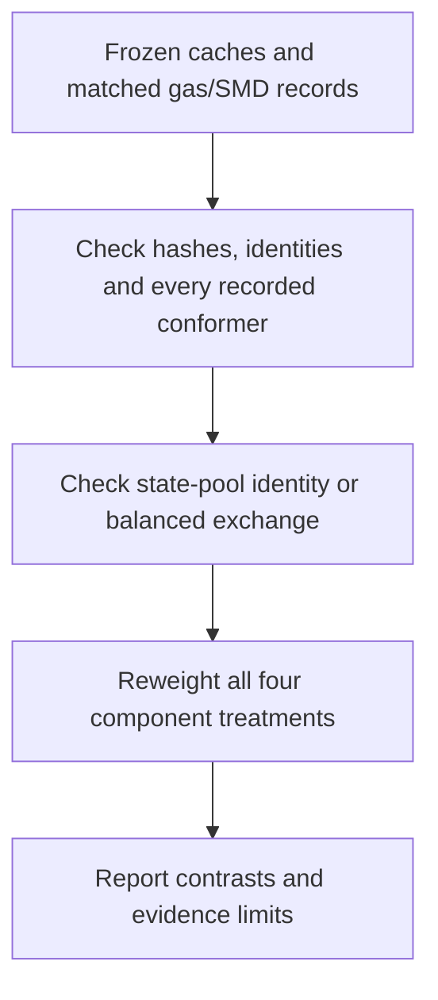

# Molecular-state and component comparisons

`metag.validation.state_ensembles` compares declared fixed-charge state pools
and balanced component exchanges using molecular caches and strict matched gas/SMD records.
It runs on CPU with the base NumPy/RDKit dependencies. It does not load UMA,
launch DFT, enumerate missing chemistry, or change the production estimator.

Each recorded minimum supplies electronic, solvation and thermal terms at a
hashed ordered geometry. The four arms are:

| Arm | Electronic term | Solvation term | Thermal term |
| --- | --- | --- | --- |
| `original` | Recorded original | Recorded original | Recorded original |
| `electronic_replaced` | Matched DFT gas | Recorded original | Recorded original |
| `solvent_replaced` | Recorded original | Matched SMD minus gas | Recorded original |
| `both_replaced` | Matched DFT gas | Matched SMD minus gas | Recorded original |

The DFT and SMD terms must come from the same converged matched pair. The SMD
total already includes CDS; it is not added again. Each arm recomputes its own
partition and populations using the production thermal scale, 2.4789 kJ/mol.
Retaining original RRHO is a controlled substitution, not a destination-DFT
minimum or entropy validation.

`component_factorial(cache, records)` requires every recorded minimum and
reconstructs the original cache energy. `geometry_hashes=[...]` instead requests
an explicit selected-minimum control. The entire parent cache must still pass
identity/component/partition checks. The report retains both parent and selected
counts and uses `sampling_scope="selected_recorded_minima"`; its energy must
not replace the full parent ensemble. Selection should be sealed before the new
energies are evaluated.

`compare_state_ensembles(caches, records, reference_state="input")` then combines
all declared states separately in each arm. States must share formula, charge,
heavy-atom skeleton and tetrahedral identity. Explicit-H and atom-mapped spellings
are normalized for identity checks. Fixed-H InChI detects duplicate or
resonance-equivalent states without merging distinct proton locations. Epimers,
unresolved stereochemistry, differing charge/proton count, hydration, isotopes,
radicals and defined bond stereochemistry across state pools are unsupported.
All source settings and replacement protocols/producers must match. The API
refuses a missing state or failed/missing required replacement.

`compare_balanced_components(caches, records, stoichiometry)` compares the same
four arms for a balanced exchange of different molecules. Every element, formal
charge and net molecular count must balance explicitly. Every recorded conformer
is required, and all sources and replacement methods must agree. No proton,
metal or liquid-water reservoir is supplied implicitly. These checks prevent a
partial species replacement or a change in elemental energy references from
appearing to be a reaction correction. Reversing or scaling the exchange reverses
or scales all four contrasts.



For files, run:

```bash
python -m metag.tools.compare_states comparison_plan.json -o new_report.json
```

For a fixed-charge state pool, the plan has exactly `reference_state` and
`states`. For a balanced component exchange, replace `reference_state` with
`stoichiometry`, a mapping from every state name to a finite nonzero coefficient.
Selected-minimum lists are unsupported for balanced exchanges. Each named state has `cache`
and `records`; a cache source is `{"path": "cache.json", "sha256": "ACTUAL_SHA256"}`.
`records` maps every required ordered-geometry SHA256 to an analogous source
object. Paths are relative to the plan or absolute. Optional `geometry_hashes`
lists must be provided for every state or omitted for all states. Record files
may contain a strict complete record, a complete `record` wrapper, or an estimated
worker output with `result.record`. The tool verifies file hashes, records the
consumed bytes and refuses an existing output. It never writes molecular caches.

These partitions describe the supplied state set only. They establish neither
exhaustive tautomer/conformer coverage nor the pH-dependent charge distribution.
No assumed pKa, reaction offset, extra degeneracy or calibrated uncertainty is
introduced. A favorable conditional shift requires independent state evidence,
related controls and a fixed-policy full-panel evaluation before production use.
The complete 13-conformer balanced deamination test is recorded in
[`deamination_balanced_plan.json`](../analysis/state_workflow_20261021_01/deamination_balanced_plan.json)
and its [CPU-reproducible report](../analysis/state_workflow_20261021_01/deamination_balanced_api.json).
It distinguishes electronic and solvent substitutions without fitting a reaction
offset; it does not establish experimental accuracy of either solvent treatment.

Neutral phase-transfer ranges are available through the same command:

```json
{
  "mode": "solvation_range",
  "states": {
    "neutral_compound": {
      "cache": {"path": "cache.json", "sha256": "ACTUAL_SHA256"},
      "reference_kj": 1.0
    }
  }
}
```

The optional reference is a central value in kJ/mol. With gas-state weights
`p_i` and fixed solvent contributions `s_i`, the transfer
`-RT log(sum(p_i exp(-s_i/RT)))` lies in `[min(s_i), max(s_i)]` for every
positive normalized choice of weights. A reference outside that range cannot
be reached by changing only electronic or thermal weights on this recorded
basis. Changing structures, solvent treatment or molecular states changes the
basis and can change the range. It is not a prediction interval, a bound on
missing basins or a confidence statement about the experimental value.

This mode requires a neutral single-molecule implicit cache with every recorded
minimum validated and its component sum checked. Source hashes are verified,
incomplete or ionic records fail, no new calculations run, and an existing
output is never overwritten. The Python API is
`metag.validation.state_ensembles.solvation_range(cache, reference_kj=...)`.
